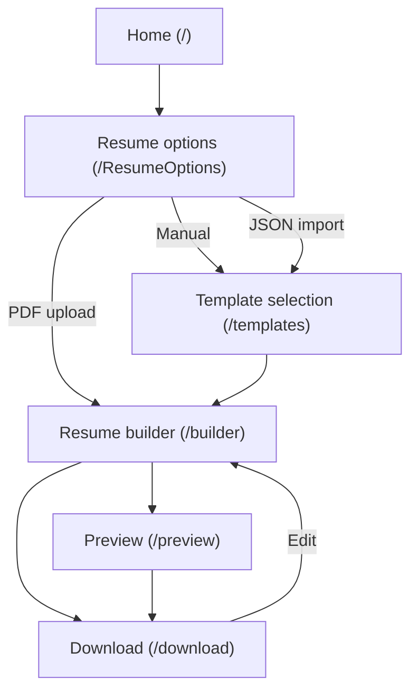
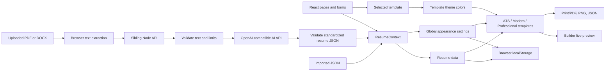

# AI Resume Builder

A browser-based resume builder built with React, Vite, and Tailwind CSS. Users can create a resume manually, import resume data from JSON, or extract text from a PDF, then edit the result, choose a template, customize its appearance, preview it, and export it.

## Getting started

Requirements: Node.js 20 or newer and npm.

```bash
npm install
npm run dev
```

Vite prints the local development URL when the server starts.

The frontend and API are separate sibling projects. Start the API separately by following `../cv-backend/README.md`; the Vite dev server listens on all local network interfaces and proxies `/api` requests to `http://127.0.0.1:3001`.

When both servers are running, use the LAN URL printed in the Vite terminal to open the frontend on another device connected to the same network. The backend also prints its LAN URL. Allow inbound TCP port `5173` through the development computer's firewall if prompted. Keep the computer and test devices on a trusted network.

Run the frontend and backend in separate terminals:

```powershell
# Terminal 1: frontend (this folder)
npm install
npm run dev

# Terminal 2: backend (sibling folder)
Set-Location ..\cv-backend
npm install
Copy-Item .env.example .env
npm run dev
```

Set the provider API key and model in the backend `.env` before testing document extraction. To change the frontend listen address use `VITE_HOST`; to proxy to a different local API address, set `VITE_API_PROXY_TARGET` in the frontend environment (for example, `http://127.0.0.1:3001`).

Useful scripts:

| Command           | Purpose                                                           |
| ----------------- | ----------------------------------------------------------------- |
| `npm run dev`     | Start the Vite development server                                 |
| `npm run build`   | Run the TypeScript project build and create the production bundle |
| `npm run lint`    | Run ESLint                                                        |
| `npm run preview` | Serve the built bundle locally                                    |

## User workflow

1. **Start a resume** from the home page using **Create Resume**.
2. **Choose an input method** on `/ResumeOptions`:
   - **Create manually** starts with the resume form.
   - **Upload Resume** extracts text from a PDF or DOCX in the browser, sends the text to the backend AI service, and maps the validated result into resume fields. Review the imported content for accuracy.
   - **Import JSON** loads a previously exported resume-data JSON file. A sample JSON file can be downloaded from this screen.
3. **Select a template** on `/templates` when that step is part of the chosen flow. Choose from ATS Friendly, Modern, Professional, Minimal, and Executive designs, filter by category, and select one-page or multi-page output.
4. **Edit and preview** on `/builder`. Edit personal information, summary, skills, experience, education, projects, certifications, awards, and languages. Toggle optional sections and use the live preview.
5. **Customize the resume** with the toolbar. Choose one-page or multi-page output, change templates, and adjust global body/heading fonts, font size, and colors. Appearance settings are stored in browser local storage.
6. **Preview and export** from `/preview` or `/download`. The download screen supports printing/saving as PDF, exporting PNG, and exporting resume data as JSON.

## Application workflow



## System design



### Main components

- **Routing:** `src/routes/AppRoutes.jsx` maps the application URLs to their page components.
- **State:** `src/context/ResumeContext.jsx` shares resume content and global appearance settings across the React app. Resume edits are mirrored to `resumeData` in local storage; appearance settings are stored under `resumeAppearance` and loaded when the app starts.
- **Template selection:** `src/pages/SelectTemplate.jsx` stores the selected template and its initial theme. Template definitions and default colors live in `src/templates/config/`.
- **Resume rendering:** `src/templates/` contains the ATS, Modern, and Professional layouts and their reusable content sections. The ATS layout uses `src/components/PaginatedResume.jsx` to split the two-column resume into preview pages and show page breaks.
- **Preview route note:** The `/preview` page currently renders the ATS template. The builder and download screens use the selected template.
- **Appearance:** `src/components/AppearanceSettingsModal.jsx` edits global fonts, font scale, and colors. `src/utils/resumeAppearance.js` applies the selected color overrides to each template's theme.
- **Document import:** `src/utils/convertDocumentToText.js` extracts PDF text with pdf.js and DOCX text with Mammoth in the browser. The text is posted to the sibling Node API, which calls the configured AI provider and validates its output against the resume data schema. Legacy `.doc` files are not supported; convert them to `.docx` first.
- **Export:** `src/pages/Download.jsx` uses `react-to-print` for PDF/print, `html-to-image` for PNG, and `file-saver` for JSON.

There is no server database or cross-device sync. Resume edits are saved in browser local storage and restored when the app is reopened or refreshed in the same browser. Use **Clear resume** in the builder to start over; the app asks for confirmation before replacing the saved resume with a blank one. Export resume data as JSON to keep a backup or move it between browsers. Appearance settings are also restored from browser storage.

## Project structure

```text
src/
  components/   Shared UI, toolbar, pagination, and settings modal
  context/      Shared resume and appearance state
  data/         Initial resume data and sample JSON
  forms/        Resume editing forms
  pages/        Home, options, builder, preview, and download screens
  routes/       React Router configuration
  templates/    Resume layouts, sections, themes, and template options
  utils/        Document text extraction, export helpers, appearance
../cv-backend/  Separate Node.js API project
  src/          API config, routes, schemas, services, and utilities
  test/         Node built-in API tests
```
